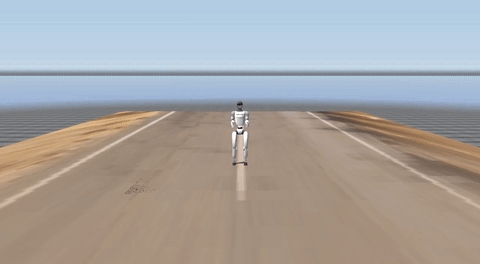
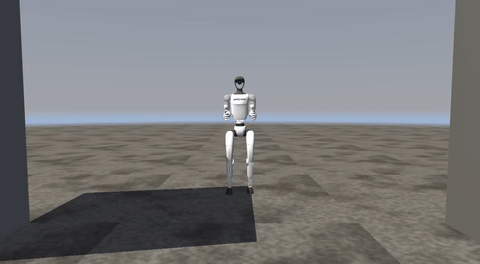
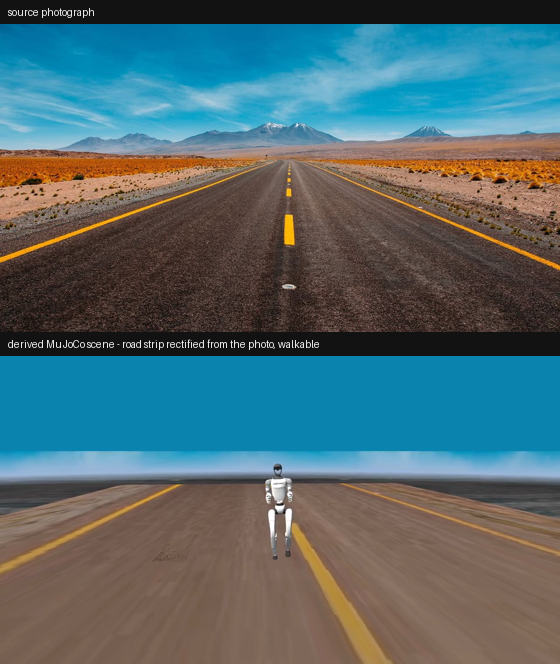

<div align="center">

# Humanoid in a Generated World

**A Unitree G1 you drive with W,A,S,D walking with real MuJoCo physics through
worlds created from a sentence or a photograph.**

</div>

---

## What this is

Type a description → a world model builds a photoreal world → a vision model turns that
image into **collidable MuJoCo geometry** → you teleoperate a Unitree G1 through it,
with real contact physics, from a browser GUI or the terminal.

```
 text ──► HappyOyster ──► photoreal frame ─┬─► LingBot World 2 ──► navigable world   (what you SEE)
                                           │
                                           └─► image_to_scene ──► MuJoCo geometry    (what you TOUCH)
```

One generated image feeds **both** halves — the world you look at and the world you
collide with derive from the same source.

## Showcase

| Photo → physics world | Teleop with real collision |
|:---:|:---:|
|  |  |
| *a highway photo, rectified into a walkable road — driven live through the GUI* | *a medieval alley preset — walls stop the robot, barrels are obstacles* |




## Quick start

```bash
python3 -m venv venv
./venv/bin/pip install mujoco torch --index-url https://download.pytorch.org/whl/cpu
./venv/bin/pip install reactor-sdk gradio pillow numpy pyyaml opencv-python
git clone https://github.com/unitreerobotics/unitree_rl_gym   # pre-trained G1 policy
echo "rk_YOUR_REACTOR_KEY" > api.js                            # gitignored

./venv/bin/python app.py        # browser GUI: create → build physics → drive
```

<div align="center">

*step 1 in the GUI: a world built from one sentence*</div>

Or straight from the terminal:

```bash
# 1. text → photoreal world frame (~30 s)
./venv/bin/python oyster_seed.py "a riverside ghat in Varanasi at golden hour"

# 2. that image → validated, walk-tested MuJoCo scene
./venv/bin/python image_to_scene.py out/seed_world.png --save ghat

# 3. drive it — W/S/A/D/Q/E, Space to stop  (fully offline)
./venv/bin/python drive_g1.py --preset ghat --no-world --preview --record out/run.mp4

# or drive inside the world model's own video
./venv/bin/python drive_g1.py --image out/seed_world.png --composite out/run.mp4 --preview
```

Steps 2–3 need **no network** — scene generation uses the Claude Code CLI, physics is
local MuJoCo, and the pre-trained policy runs on CPU.

## The finding

We set out to answer: **can a generative world model be a robot's environment?**
We built both architectures and compared them:

| | World model as environment | Simulator as environment |
|---|---|---|
| Scenery | photorealistic | built geometry |
| **Physics with the scene** | **none** | **real collision & footing** |
| Robot motion | real, composited on top | real, native |
| Usable take length | ~8–10 s before drift | unlimited |

**World models emit observations, not state.** Physics needs state you can query and
integrate — so a world model can be a robot's *scenery* or its *imagination*, never its
*environment*. We use each for what it's good at.

## Measured, because the docs were wrong

The vendor's two documentation pages contradict each other on resolution and frame rate.
Both are wrong. Everything below is measured (full method in [`RESULTS.md`](RESULTS.md),
regenerated locally):

| | documented | measured |
|---|---|---|
| LingBot resolution | 1664×960 *or* 480p | **1664×960** |
| LingBot frame rate | 48 fps *or* 16 fps | **36.5 fps delivered** |
| Generation speed | "<1 s latency" | **0.25× realtime** (0.1333 s media/chunk, constant) |
| `attn_window` speedup | — | **~10 % max** — throughput is a hard ceiling |
| Models on the API | 7 in the docs | **24** via `GET /models` |
| G1 policy vs terrain | — | **terrain-blind: a 6 cm step topples it** |

That last measurement shapes the whole system: every generated scene is **validated**
(props ≥ 0.4 m, clear corridor, spawn kept clear) and **walk-tested headlessly** before
you're allowed to drive it.

## What's in here

| file | role |
|---|---|
| `app.py` | browser GUI — create world → build physics → teleoperate |
| `oyster_seed.py` | text → photoreal world frame (HappyOyster) |
| `image_to_scene.py` | image → validated MJCF scene (layout + palette + rectified ground + sky) |
| `scene_builder.py` | presets, procedural textures, perspective rectification |
| `scene_validate.py` | the safety gate: heights, corridor, spawn, auto-repair |
| `scene_describe.py` | text → MJCF scene (no image needed) |
| `drive_g1.py` | WASD teleop, chase cam, recording, LingBot compositing |
| `generate_video.py` | photo → world-model video (prompt-validated, `--dry-run`) |
| `x2_restyle.py` | MuJoCo render → X2 video-to-video restyle |
| `DEMO.md` | presenter notes |

## Stack

**MuJoCo 3.12** (physics + rendering) · **Unitree G1** 12-DOF with the pre-trained
`motion.pt` policy from [unitree_rl_gym](https://github.com/unitreerobotics/unitree_rl_gym)
(TorchScript LSTM, 47 obs → 12 actions, CPU) · **HappyOyster**, **LingBot World 2**,
**X2** via [Reactor](https://reactor.inc) · **Claude** (Claude Code CLI) for geometry ·
**Gradio** for the GUI. Nothing was trained.

## Honest limits

- The robot **cannot collide** with world-model scenery — that composite is a 2D
  paste-over with a drawn contact shadow.
- Generated geometry is **boxes, cylinders, spheres** — correct in plan view, not detailed.
- **No stairs or slopes**: the policy has no terrain sensing, so scenes are flattened by
  design.
- World-model takes drift after **~8–10 s**; short re-seeded takes beat long ones.
